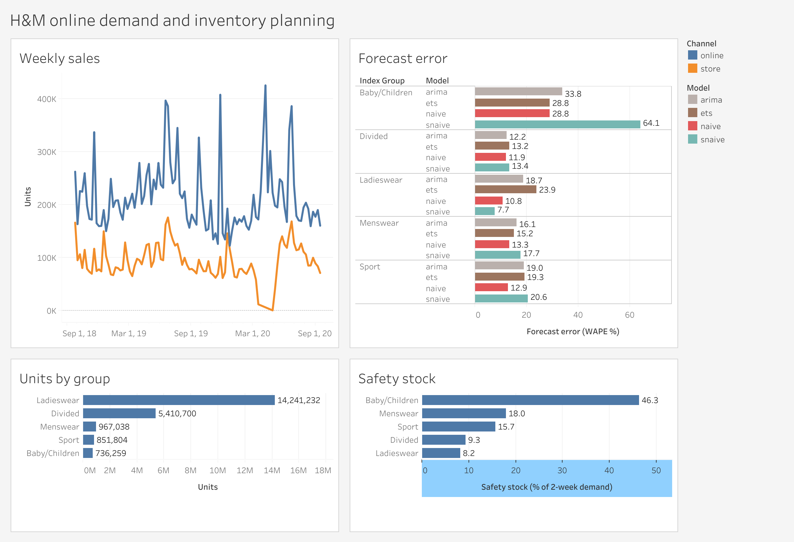
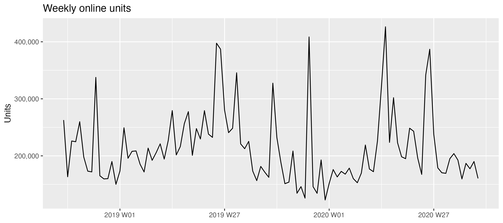
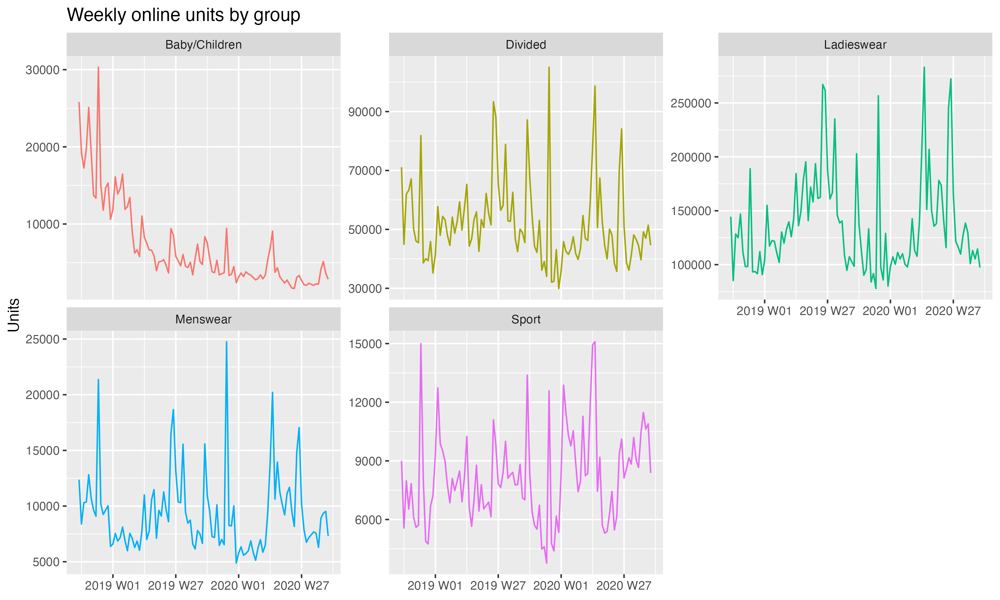
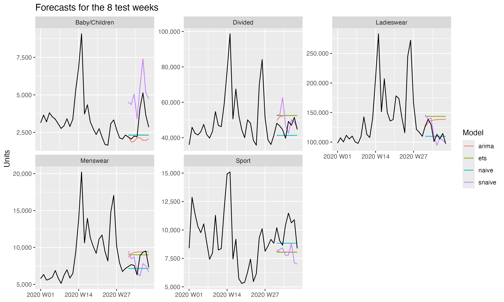

# E-commerce Demand & Inventory Planning

Demand and inventory planning on real transaction data from H&M's Kaggle
competition (31.8M purchases, Sep 2018 to Sep 2020).

The project works through the questions a planning team faces every week:
how much each product group is going to sell online, how wrong that
forecast can be, and how much extra stock is needed to cover it.

**Dashboard:** [H&M Demand and Inventory Planning on Tableau Public](https://public.tableau.com/app/profile/monique.aoyama/viz/HMDemandandInventoryPlanning/Dashboard)

## Main results

- Online is 70% of units and 76% of revenue. Ladieswear alone is 64% of
  online units.
- Online sales fell 7.8% from the first year to the second, and the drop
  started months before the pandemic.
- Simple models beat the complex ones. Seasonal naive forecast Ladieswear
  with 7.7% error, while ETS and ARIMA were between 18.7% and 23.9%.
- Baby/Children needs safety stock equal to 46% of its 2-week demand.
  Ladieswear needs only 8%, because its sales are much more predictable.

## Data

Source: [H&M Personalized Fashion Recommendations](https://www.kaggle.com/competitions/h-and-m-personalized-fashion-recommendations/data)

| Table | Rows | Description |
| --- | --- | --- |
| transactions | 31.8M | purchase date, customer, article, price, sales channel |
| articles | 105K | product attributes and hierarchy |
| customers | 1.37M | customer attributes |

The analysis focuses on online sales, with store sales used for comparison.
The dataset has no inventory information, so safety stock and reorder
points are calculated from the forecasts and their errors.

## Database

The files are loaded into a DuckDB database with three layers.

| Layer | Tables | Content |
| --- | --- | --- |
| raw | transactions_train, articles, customers | Kaggle files, unchanged |
| clean | transactions, articles | clearer column names, sales channel as text |
| mart | weekly_sales | units and revenue by week, channel and index group |

The weekly table covers 104 full weeks. The first and last weeks of the
dataset are incomplete, so they were left out. The table is also exported
to [exports/weekly_sales.csv](exports/weekly_sales.csv) for R and Tableau.

## Data checks

- The dataset does not say which channel code is online. Channel 1 has no
  sales in April 2020, which matches the store closures, so channel 1 is
  stores and channel 2 is online.
- Online has sales in all 104 weeks for every index group. Stores have a
  gap of five to six weeks in spring 2020.

## Business questions

| | Question | Answer |
| --- | --- | --- |
| [Q1](sql/analysis/q1_sales_by_channel.sql) | Which channel sells more? | Online has 70% of units and 76% of revenue. The average online item costs about 30% more than in stores. |
| [Q2](sql/analysis/q2_top_index_groups.sql) | Which groups sell the most online? | Ladieswear and Divided together are 88.5% of online units. The other three groups are under 5% each. |
| [Q3](sql/analysis/q3_weekly_trend.sql) | What were the peak weeks online? | Black Friday, mid-June in both years, and April 2020 when stores were closed. |
| [Q4](sql/analysis/q4_year_over_year.sql) | How much did each group grow from year 1 to year 2? | Online fell 7.8%. Only Sport grew. Baby/Children fell 64%. |
| [Q4b](sql/analysis/q4b_monthly_yoy.sql) | Did the drop start before the pandemic? | Yes. Every month from Oct 2019 to Feb 2020 sold less than a year before. Only Mar and Apr 2020 were above. |
| [Q5](sql/analysis/q5_moving_average.sql) | How stable is weekly demand? | A typical week lands 15% to 19% away from its 4-week average, similar across groups. |

Also explored:

- [Channel mix](explore/groups_by_channel.sql): Divided sells relatively
  more online, while Menswear and Baby/Children sell relatively more in
  stores. Stock for one channel shouldn't copy the other.
- [Monthly sales by group](explore/monthly_by_group.sql): Baby/Children
  dropped from about 20,000 to 7,000 units a week between Oct 2018 and
  Mar 2019, and stayed low. Not related to the pandemic.

## Weekly online sales

The peaks from Q3 are easy to spot: Black Friday, mid-June in both years
and April 2020. December is low in both years.

Each group has its own scale. Ladieswear, Divided, Menswear and Sport repeat
their peaks every year, while Baby/Children falls steadily and stays low.
Charts made in R ([R/01_explore.R](R/01_explore.R)).

What this meant for the forecast:

- The June and Black Friday peaks repeat every year, so the models need
  yearly seasonality. Two years of data give only two examples of each.
- April 2020 is a one-off spike from the store closures, not normal demand.
- Baby/Children moved to a much lower level in early 2019, so its older
  weeks don't describe current demand.

## Was the drop real?

[R/04_hypothesis_test.R](R/04_hypothesis_test.R) pairs each week of the
second year with the same week of the first year, so seasonality doesn't
get in the way. The average week went from 222,137 to 204,921 units, and
39 of the 52 weeks sold less.

| Test | Result |
| --- | --- |
| Paired t-test | p = 0.084 |
| Wilcoxon signed-rank (paired) | p = 0.002 |

The two tests disagree because of a few extreme weeks, like April 2020 and
Black Friday landing in a different week each year. The Wilcoxon test is less
affected by those, so it's the one used here: the drop is real.

## Forecast

Code in [R/02_forecast.R](R/02_forecast.R).

The last 8 weeks are held out to test the models. They learn from the first
96 weeks (2018 W39 to 2020 W30) and are compared with what actually sold in
the last 8 (2020 W31 to W38). The split follows time instead of picking
random weeks, since a forecast can only learn from the past.

Four models for each group:

- **naive**: next week sells the same as the last week
- **snaive**: same week last year
- **ets**: exponential smoothing, without seasonality (ETS can't handle a
  52-week season)
- **arima**: chosen automatically by `fpp3`

Error on the 8 test weeks (WAPE %, lower is better):

| Group | naive | snaive | ets | arima |
| --- | --- | --- | --- | --- |
| Ladieswear | 10.8 | **7.7** | 23.9 | 18.7 |
| Divided | **11.9** | 13.4 | 13.2 | 12.2 |
| Menswear | **13.3** | 17.7 | 15.2 | 16.1 |
| Sport | **12.9** | 20.6 | 19.3 | 19.0 |
| Baby/Children | **28.8** | 64.1 | 28.8 | 33.8 |

All groups together, snaive had 11.2% error and naive 11.6%, against 17.2%
for ARIMA and 20.6% for ETS. ETS and ARIMA also overforecast by 13% to 18%.

Seasonal naive works for Ladieswear because its yearly pattern is strong.
For the other groups, last week is a better guide than last year. For
Baby/Children last year is a bad guide (64% error) because the group sold
much more back then. Naive and ETS tie at 28.8% there, so naive was kept
because it's simpler.

The chosen models are refit on all 104 weeks to forecast the next 8:
[exports/forecast_next_8_weeks.csv](exports/forecast_next_8_weeks.csv).

## Safety stock

Code in [R/03_inventory.R](R/03_inventory.R).

Safety stock covers the weeks when demand is higher than the forecast. It
uses the forecast errors from the test weeks, with two assumptions: a
2-week lead time and a 95% service level.

    safety stock = 1.64 x (std dev of weekly error) x sqrt(2 weeks)
    reorder point = forecast for the next 2 weeks + safety stock

| Group | Model | 2-week demand | Safety stock | Reorder point | Safety stock % |
| --- | --- | --- | --- | --- | --- |
| Ladieswear | snaive | 340,398 | 27,933 | 368,331 | 8.2 |
| Divided | naive | 89,246 | 8,286 | 97,532 | 9.3 |
| Sport | naive | 16,756 | 2,629 | 19,385 | 15.7 |
| Menswear | naive | 14,644 | 2,636 | 17,280 | 18.0 |
| Baby/Children | naive | 5,696 | 2,638 | 8,334 | 46.3 |

The small groups need about the same safety stock in units as each other,
but for Baby/Children that's almost half of what it sells in two weeks.
Its demand is the hardest to predict, so it's the group with the most
risk of having too much or too little stock.

Results in [exports/inventory_policy.csv](exports/inventory_policy.csv).

## Limitations

- The models are tested on only one window of 8 weeks, during the pandemic.
  Testing on several windows (rolling origin) would give a more reliable
  comparison.
- Lead time and service level are assumptions, since the data has no
  supplier information.
- Prices in the dataset are scaled, so revenue can only be compared in
  relative terms.

## Future work

- Rolling origin testing for the forecast models
- Yearly seasonality in ETS and ARIMA (Fourier terms)
- Machine learning models, compared with the simpler ones
- Forecast vs actual and a group filter in the dashboard
- Compare prices of the same articles online and in stores
- Monthly S&OP report

## How to run

Download the three CSV files from Kaggle into `data/raw/`, then:

    python -m venv .venv
    source .venv/bin/activate
    pip install -r requirements.txt
    python src/01_load_raw.py
    python src/run_sql.py sql/02_clean/01_transactions.sql
    python src/run_sql.py sql/02_clean/02_articles.sql
    python src/run_sql.py sql/04_marts/01_weekly_sales.sql
    python src/run_sql.py sql/05_export/01_weekly_sales.sql

Any file in `sql/analysis/` runs the same way.

For the R part, open `ecommerce-demand-inventory-planning.Rproj` in RStudio,
install the packages once with
`install.packages(c("tidyverse", "fpp3", "urca"))`, and run the scripts in
`R/` in order. They only need `exports/weekly_sales.csv`, which is already
in the repo.

## Tools

Python, SQL, DuckDB, R (tidyverse, fpp3), Tableau Public

## Contact

Monique Aoyama · [LinkedIn](https://www.linkedin.com/in/moniqueaoyama/)
